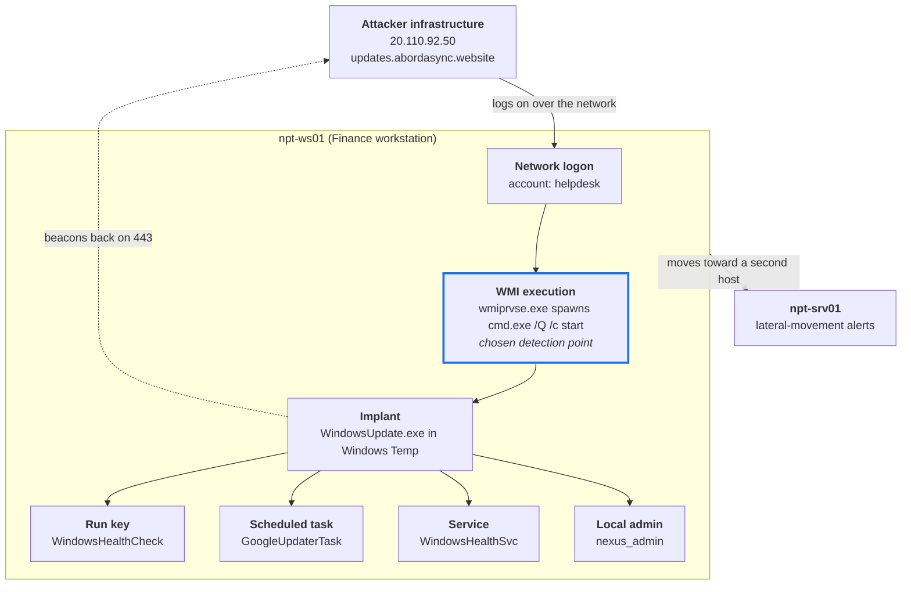

# Incident Report: NPT-WS01 Intrusion

> [!IMPORTANT]
> **True positive, high severity.** On 22 April 2026 (04:30 to 06:00 UTC) an attacker at `20.110.92.50` logged on to `npt-ws01` as `helpdesk`, ran an implant through WMI, installed four persistence mechanisms and moved toward `npt-srv01`.
 
**Ticket** #4451 · **Platform** Microsoft Defender for Endpoint (Advanced Hunting, KQL) · **Frameworks** NIST SP 800-61, MITRE ATT&CK

## Contents

- [Summary](#summary)
- [Attack path](#attack-path)
- [1. Preparation](#1-preparation)
- [2. Detection and analysis](#2-detection-and-analysis)
  - [How it was detected](#how-it-was-detected)
  - [Detection point and why](#detection-point-and-why)
  - [Reconstructed timeline](#reconstructed-timeline)
  - [Indicators of compromise](#indicators-of-compromise)
  - [Scope](#scope)
  - [Impact](#impact)
- [3. Containment](#3-containment) 
- [4. Eradication](#4-eradication) 
- [5. Recovery](#5-recovery)
- [6. Post-incident activity](#6-post-incident-activity)
- [Open questions](#open-questions)
- [Appendix: hunting queries](#appendix-hunting-queries)

---

## Summary

Ticket #4451 is a confirmed hands-on-keyboard compromise of NPT-WS01 with lateral movement toward npt-srv01. It is not a nuisance prompt.

| Item | Finding |
| --- | --- |
| Reported | 22 April 2026, 09:14 UTC, by Mark Smith (Finance) |
| Patient zero | `npt-ws01` |
| Second host | `npt-srv01` |
| Compromised account | `helpdesk` |
| Attacker source and C2 | `20.110.92.50`, `updates.abordasync.website` |
| Implant | `C:\Windows\Temp\WindowsUpdate.exe` |
| Persistence | Run key, scheduled task, Windows service, backdoor local administrator |

The attacker holds valid credentials, a working C2 channel and four independent ways back in. Until every one is removed, the host must be treated as attacker-controlled.

The gap between the end of activity (about 06:00 UTC) and the ticket (09:14 UTC) was more than three hours. Defender raised alerts in the window, but triage began only when the user reported it.

## Attack path
 

 
The highlighted step is the earliest point where the activity is clearly malicious. Everything after it on the workstation, and the move to npt-srv01, happens later.

---

## 1. Preparation

Preparation decided what could be seen and how fast. The telemetry was good enough to reconstruct the whole attack; the exposure and response controls were not good enough to stop it.

| Area | State during the incident | Effect |
| --- | --- | --- |
| Endpoint telemetry | npt-ws01 onboarded to Microsoft Defender for Endpoint | Logon, process, network, file and registry events were all available in Advanced Hunting |
| Reporting channel | Help desk ticketing in use | The user report reached the SOC, but hours late |
| Alert triage | Alerts fired on npt-ws01 and npt-srv01 without overnight response | The attacker worked for the full window uninterrupted |
| Remote access exposure | A public IP completed a network logon and reached RDP on a workstation | Remote management ports were reachable from the internet |
| Privileged accounts | `helpdesk` could run remote WMI and create services and local admins | One password gave full control of the host |
| User awareness | The user dismissed repeated RDP prompts and went back to sleep | An early warning sign was lost |

> [!NOTE]
> The exposure and privilege rows are inferred from attacker behaviour in the telemetry. They should be confirmed against firewall rules and group membership.

---

## 2. Detection and analysis

### How it was detected

The incident was detected by a user report, then confirmed by hunting. Mark Smith reported overnight Remote Desktop prompts asking whether to allow `m.smith` to connect. That prompt appears when a second session tries to take over a logged-on user's desktop, so someone else was presenting Mark's account to his own machine.

The hunt started in Advanced Hunting, scoped to npt-ws01 from 21 to 23 April 2026, and worked outward from authentication:

1. **Logons.** Successful network logons (LogonType 3) in the window showed `helpdesk` authenticating from the public address 20.110.92.50.
2. **Processes.** Everything run under `helpdesk` showed `cmd.exe` silently starting a binary from a Temp folder.
3. **Parent chain.** That `cmd.exe` was spawned by `wmiprvse.exe`, which confirmed remote WMI execution, not a local user.
4. **Network, file, registry.** Pivoting on the binary gave the C2 domain, the file hash and the persistence artifacts.
5. **Fleet.** Alert evidence across the npt- hosts showed a second device, npt-srv01.

### Detection point and why

The chosen detection point is this process chain:

```text
wmiprvse.exe
└── cmd.exe /Q /c start "" "C:\Windows\Temp\WindowsUpdate.exe"
```

It is the earliest event where malicious intent is unambiguous, and it fires before any persistence exists.

| Candidate detection point | Timing | Fidelity | Verdict |
| --- | --- | --- | --- |
| Repeated RDP prompts and failed logons | Earliest | Low: noisy, common on exposed hosts | Useful precursor, not proof |
| `helpdesk` network logon from a public IP | Early | Medium: help desk accounts log on remotely by design | Strong when the source is external; alert on it as well |
| `wmiprvse.exe` spawning `cmd.exe /Q /c` to run a Temp binary | Early, before persistence | High: admins rarely launch executables from Temp through WMI | **Chosen** |
| Beacon to `updates.abordasync.website` | After execution | High, but only once the IOC is known | Good for scoping, poor for first detection |
| Run key, task, service, new admin | Late | High | Detects the attacker after they are already entrenched |

Three reasons support the choice:

- **It is behaviour, not an indicator.** The attacker can change IP, domain, hash and file name for free. Changing how Impacket-style WMI execution looks on the endpoint costs them a tool.
- **It is specific.** The combination of WMI provider host as parent, a quiet `/Q /c` shell, and an executable in `C:\Windows\Temp` named like a Windows component has few legitimate explanations.
- **It leaves time to act.** Containing at this point would have prevented all four persistence mechanisms and the move to npt-srv01.

The logon from a public IP should be a second, paired detection. Together they tell the full story: who got in, and what they did first.

### Reconstructed timeline

The attack ran from initial access to lateral movement inside one 90-minute window on 22 April 2026 (04:30 to 06:00 UTC). Steps are listed in attack order; exact times come from the `Timestamp` column of each evidence row.

| # | Stage | What happened | Evidence (table → column) | MITRE ATT&CK |
| --- | --- | --- | --- | --- |
| 1 | Precursor | Repeated RDP prompts for `m.smith` on NPT-WS01 through the night | Ticket #4451; `DeviceLogonEvents` | T1021.001 Remote Desktop Protocol |
| 2 | Initial access | `helpdesk` logs on over the network from 20.110.92.50 | `DeviceLogonEvents` → `AccountName`, `RemoteIP` | T1078 Valid Accounts |
| 3 | Tool transfer | Implant written to `C:\Windows\Temp\WindowsUpdate.exe` over the network | `DeviceFileEvents` → `SHA256` | T1570 Lateral Tool Transfer, T1036.005 Masquerading |
| 4 | Execution | `wmiprvse.exe` spawns `cmd.exe /Q /c start "" "C:\Windows\Temp\WindowsUpdate.exe"` | `DeviceProcessEvents` → `ProcessCommandLine`, `InitiatingProcessFileName` | T1047 Windows Management Instrumentation |
| 5 | Command and control | Implant beacons to `updates.abordasync.website` on 443, which resolves to 20.110.92.50 | `DeviceNetworkEvents` → `RemoteUrl` | T1071.001 Web Protocols |
| 6 | Persistence | Run-key value `WindowsHealthCheck` points at the implant | `DeviceRegistryEvents` → `RegistryValueName` | T1547.001 Registry Run Keys |
| 7 | Persistence | Scheduled task `GoogleUpdaterTask` created with `schtasks.exe /create` | `DeviceProcessEvents` → `ProcessCommandLine` | T1053.005 Scheduled Task |
| 8 | Persistence | Service `WindowsHealthSvc` created with `sc.exe create`, binPath at the implant | `DeviceProcessEvents` → `ProcessCommandLine` | T1543.003 Windows Service |
| 9 | Persistence and privilege | Local user `nexus_admin` created, then added to Administrators seconds later | `DeviceProcessEvents` → `ProcessCommandLine` | T1136.001 Local Account, T1098 Account Manipulation |
| 10 | Lateral movement | Activity and alerts appear on npt-srv01 | `AlertEvidence`, `DeviceInfo` → `DeviceName` | T1021 Remote Services |

> [!NOTE]
> The order of steps 6 to 9 follows the hunt sequence and should be confirmed against timestamps.

### Indicators of compromise

| Type | Value | Role |
| --- | --- | --- |
| IPv4 | `20.110.92.50` | Attacker logon source and C2 address |
| Domain | `updates.abordasync.website` | C2, resolves to the IP above |
| File path | `C:\Windows\Temp\WindowsUpdate.exe` | Implant |
| SHA256 | `20cef6a013953890f9d38605d25d60dd63b42b09946bbb18ddb4a456da306e77` | Implant hash |
| Command line | `cmd.exe /Q /c start "" "C:\Windows\Temp\WindowsUpdate.exe"` | wmiexec-style launch |
| Account | `helpdesk` | Compromised, used for access |
| Account | `nexus_admin` | Attacker-created local administrator |
| Registry value | `WindowsHealthCheck` under `...\CurrentVersion\Run` | Autostart persistence |
| Scheduled task | `GoogleUpdaterTask` | Persistence |
| Service | `WindowsHealthSvc` | Persistence, runs the implant |

The same address serves as logon source and C2. That ties the `helpdesk` logon and the implant to one operator.

### Scope

Two hosts and three accounts are in scope.

| Entity | Status | Basis |
| --- | --- | --- |
| `npt-ws01` | Confirmed compromised | Remote code execution, C2 and four persistence mechanisms |
| `npt-srv01` | Treat as compromised | Lateral-movement activity observed; needs a full hunt to clear it |
| `helpdesk` | Confirmed compromised | The attacker knew the password or hash before the window opened |
| `m.smith` | Suspected | The RDP prompts named this account, so its credentials were at least being tried |
| `nexus_admin` | Attacker-owned | Created by the attacker |

### Impact

| NIST 800-61 category | Rating | Basis |
| --- | --- | --- |
| Functional impact | Low | No outage; the user reported the machine as fine in the morning |
| Information impact | Integrity loss confirmed; confidentiality not yet determined | System configuration altered on a Finance workstation; exfiltration has not been assessed |
| Recoverability | Supplemented | One workstation rebuild, one server review, credential resets beyond the affected user |

The business risk is higher than the functional rating suggests. The host belongs to Finance, the attacker had administrator-level control, and a server was reached.

---

## 3. Containment

Contain both hosts and all three accounts at the same time, then block the infrastructure. Doing it piecemeal lets the attacker use one foothold to rebuild another.

### Step 1: Isolate the hosts

| Action | Target | How |
| --- | --- | --- |
| Isolate device (full isolation) | `npt-ws01` | Defender portal, device page, Isolate device. The host keeps its Defender connection for investigation and loses everything else |
| Isolate device | `npt-srv01` | Same action. If the server is business-critical, agree a short outage with its owner first, but do not skip it |
| Do not power off | Both | Memory holds the running implant and its C2 configuration |

### Step 2: Preserve evidence before changing anything

| Action | Target | How |
| --- | --- | --- |
| Collect investigation package | `npt-ws01`, `npt-srv01` | Defender device action; captures autoruns, services, tasks, sessions, event logs |
| Acquire the implant | `C:\Windows\Temp\WindowsUpdate.exe` | Defender Collect file, or live response `getfile`; verify the SHA256 matches |
| Capture memory and disk image | `npt-ws01` | Forensic tooling over live response, if the case may go to legal or HR |
| Export hunt results | All queries in the appendix | Save with timestamps; start a chain-of-custody log |

### Step 3: Cut off the accounts

| Account | Action | Reason |
| --- | --- | --- |
| `helpdesk` | Disable now, revoke sessions and tokens, reset the password | Confirmed attacker access |
| `nexus_admin` | Disable now on npt-ws01; check every other host for the same name | Attacker-created local administrator |
| `m.smith` | Force password reset, revoke sessions, re-register MFA | Named in the RDP prompts, so the credentials are suspect |
| Accounts with sessions on either host during the window | Reset passwords | Credentials in memory may have been harvested |

### Step 4: Block the indicators

| Indicator | Where to block |
| --- | --- |
| `20.110.92.50` | Perimeter firewall, inbound and outbound; Defender custom indicator (Block) |
| `updates.abordasync.website` | DNS sinkhole or filter; web proxy; Defender custom indicator (Block) |
| SHA256 `20cef6a0...06e77` | Defender file indicator set to Block and remediate, so it is quarantined fleet-wide |

### Step 5: Check for spread

Sweep every npt- device for the hash, the domain, the IP, the four persistence names and `wmiprvse.exe` spawning `cmd.exe /Q /c`. Any hit joins the isolation list and the plan repeats for that host.

### Containment is complete when

- Both hosts show as isolated in the Defender portal
- No device in the fleet has contacted the IP or domain since the block
- `helpdesk` and `nexus_admin` show no successful logons anywhere after being disabled

---

## 4. Eradication

Remove all six artifacts on npt-ws01 in the order below, then rebuild the host. The attacker had administrator-level control, so manual cleanup proves the known artifacts are gone but cannot prove nothing else was left.

| # | Artifact | Verify |
| --- | --- | --- |
| 1 | Running implant process `WindowsUpdate.exe` | No process with that hash is running |
| 2 | Service `WindowsHealthSvc` | `sc.exe query` returns error 1060 (service does not exist) |
| 3 | Scheduled task `GoogleUpdaterTask` | `schtasks.exe /query` finds nothing |
| 4 | Run-key value `WindowsHealthCheck` | `reg query` on the Run key no longer lists the value |
| 5 | Implant file `C:\Windows\Temp\WindowsUpdate.exe` | File absent; hash blocked by the Defender indicator |
| 6 | Local account `nexus_admin` | `net user` and the Administrators group no longer list it |

```bat
:: 1. Stop the implant (or use Defender "Stop and quarantine file" on the SHA256)
taskkill /F /IM WindowsUpdate.exe

:: 2. Remove the service
sc.exe stop WindowsHealthSvc
sc.exe delete WindowsHealthSvc

:: 3. Remove the scheduled task
schtasks.exe /delete /tn "GoogleUpdaterTask" /f

:: 4. Remove the Run-key value (replace <hive> with HKLM or HKCU)
reg delete "<hive>\Software\Microsoft\Windows\CurrentVersion\Run" /v WindowsHealthCheck /f

:: 5. Remove the implant file, after the evidence copy is secured
del /F "C:\Windows\Temp\WindowsUpdate.exe"

:: 6. Remove the backdoor account, then delete its profile folder
net localgroup Administrators nexus_admin /delete
net user nexus_admin /delete
```

> [!WARNING]
> Stop the process first. A live implant can recreate the other artifacts as they are deleted.

- **Step 4 hive:** take HKLM or HKCU from the `RegistryKey` column of the same `DeviceRegistryEvents` row as the value name.
- **Steps 2 and 3:** a genuine Google updater task or Windows service may exist with a similar name. Match on the exact names above and on a path pointing to `C:\Windows\Temp`.

### npt-srv01

Run the same hunt on npt-srv01 across the same window before deciding between cleanup and rebuild. Look for the same hash, the same four persistence names, new local accounts, new services and logons by `helpdesk` or from npt-ws01.

### Remove the root cause

- **Credentials.** Reset `helpdesk` and rotate any password or secret that account could read. If `helpdesk` is a domain account, review where else it logged on in the 30 days before 22 April 2026.
- **Exposure.** Close inbound RDP (3389), SMB (445) and RPC/WMI (135 and dynamic ports) from the internet to workstations. Remote administration goes through VPN or a jump host with MFA.
- **How the password was obtained.** This is not yet known and is the main open question. Check for password spraying, reuse and earlier phishing against help desk staff.

---

## 5. Recovery

Return npt-ws01 to service from a clean image, not from the cleaned-up disk, and watch both hosts closely for 30 days.

1. **Rebuild npt-ws01.** Reimage from a known-good baseline, patch fully, and re-onboard to Defender for Endpoint before it rejoins the network.
2. **Restore data.** Restore Mark Smith's files from a backup taken before 22 April 2026, or scan current files before copying them back.
3. **Decide on npt-srv01.** Rebuild if the hunt finds execution or persistence. If it finds only failed or blocked attempts, keep it and document the evidence for that decision.
4. **Reissue credentials.** New `helpdesk` password with MFA enforced; new credentials for `m.smith`; local administrator passwords rotated on both hosts.
5. **Validate before release.** Confirm no Run-key value, task, service or account from this report exists; confirm a full antivirus scan is clean; confirm Defender shows the device healthy and reporting.
6. **Release from isolation.** Release npt-srv01 and the rebuilt npt-ws01 only after step 5 passes for each.
7. **Monitor.** Keep the IOC blocks in place and run the detection queries in the appendix as scheduled custom detections.

### Signs the attacker is back

| Signal | Meaning |
| --- | --- |
| Any connection attempt to `20.110.92.50` or `updates.abordasync.website` | A missed implant or a second infected host |
| Logon attempts by `helpdesk` or `nexus_admin` from unexpected sources | Attacker testing old credentials |
| `wmiprvse.exe` spawning `cmd.exe /Q /c` on any npt- device | Same tooling, new foothold |
| A new local administrator, service or Run-key value on either host | Re-established persistence |
| Network logons from public IPs to any workstation | The exposure is still open |

---

## 6. Post-incident activity

The main lesson is that the telemetry saw everything and nobody was looking. Hold a lessons-learned review within two weeks of closure and track the actions below to completion.

| What happened | Gap | Improvement |
| --- | --- | --- |
| A public IP logged on to a workstation | Remote management reachable from the internet | Block inbound 3389, 445 and 135 at the perimeter; require VPN or jump host with MFA |
| One shared account gave full control | `helpdesk` is over-privileged and password-only | Named admin accounts, least privilege, MFA, LAPS for local administrators |
| WMI ran a binary from Temp unchallenged | No behavioural rule on this chain | Custom detection on `wmiprvse.exe` spawning `cmd.exe`; attack surface reduction rule to block process creation from PSExec and WMI commands |
| Four persistence mechanisms were created | No alerting on new services, tasks, Run keys or local admins | Custom detections for each, scoped to non-standard paths and names |
| Alerts fired overnight without response | No out-of-hours triage | On-call rotation or automated isolation for high-severity alerts |
| The user ignored the prompts | Users do not recognise unexpected RDP prompts as an attack | Short awareness note: unexpected login prompts are reported immediately |

### Follow-up actions

- Deploy the paired custom detections (public-IP logon, WMI-spawned shell) to the whole tenant
- Audit every npt- device for inbound internet exposure on 3389, 445 and 135
- Replace the shared `helpdesk` account with named accounts under MFA
- Enable account lockout and alerting on repeated failed logons
- Add this incident's IOCs to the threat intelligence list and share them with peers as policy allows
- Update the incident response playbook with the containment order used here
- Record time to detect, time to contain and time to recover for this incident
- Retain evidence according to the retention policy and any legal hold

---

## Open questions

These are not answered by the evidence reviewed so far and should be closed before the incident is.

- **How did the attacker get the `helpdesk` password?** Check for failed logons against it before the window, and for reuse elsewhere.
- **Was data taken?** Review outbound volume from npt-ws01 to 20.110.92.50 and file access under `helpdesk` during the window.
- **What ran on npt-srv01?** The evidence shows the attacker moved toward it; it does not yet show whether execution succeeded.
- **What else is in the incident graph?** The Defender graph for this incident shows more entities than the flags cover: 6 users, 14 processes, 12 files, registry values, a `powershell.exe` file node, a security group, an internal address and at least one further device. Each needs to be explained or added to scope.
- **Were the RDP prompts the same actor?** Compare the source address of the `m.smith` RDP attempts with 20.110.92.50.

---

## Appendix: hunting queries

Each query reproduces one finding in Advanced Hunting. Paste these three `let` lines above every query.

```kusto
let start_time = datetime(2026-04-21T00:00:00.00Z);
let end_time = datetime(2026-04-23T00:00:00.00Z);
let HostInQuestion = "npt-ws01";
```

<details>
<summary><b>Logon and source</b> (timeline steps 1 and 2)</summary>

```kusto
DeviceLogonEvents
| where Timestamp between (start_time .. end_time)
| where DeviceName startswith HostInQuestion
| where ActionType == "LogonSuccess" and LogonType == "Network"
| summarize Logons = count(), FirstSeen = min(Timestamp), LastSeen = max(Timestamp)
    by AccountName, RemoteIP, LogonType
| order by FirstSeen asc
```

</details>

<details>
<summary><b>Execution and parent chain</b> (step 4)</summary>

```kusto
DeviceProcessEvents
| where Timestamp between (start_time .. end_time)
| where DeviceName startswith HostInQuestion
| where AccountName =~ "helpdesk" or InitiatingProcessFileName =~ "wmiprvse.exe"
| project Timestamp, AccountName, FileName, ProcessCommandLine,
    InitiatingProcessFileName, InitiatingProcessParentFileName
| order by Timestamp asc
```

</details>

<details>
<summary><b>Command and control</b> (step 5)</summary>

```kusto
DeviceNetworkEvents
| where Timestamp between (start_time .. end_time)
| where DeviceName startswith HostInQuestion
| where RemotePort == 443 and isnotempty(RemoteUrl)
| where RemoteUrl !endswith "microsoft.com"
    and RemoteUrl !endswith "windows.com"
    and RemoteUrl !endswith "azure.com"
| summarize Connections = count(), FirstSeen = min(Timestamp)
    by RemoteUrl, RemoteIP, InitiatingProcessFileName
```

</details>

<details>
<summary><b>Implant file and hash</b> (step 3)</summary>

```kusto
DeviceFileEvents
| where Timestamp between (start_time .. end_time)
| where DeviceName startswith HostInQuestion
| where ActionType == "FileCreated" and FileName endswith ".exe"
| where FolderPath contains @"\Temp\" or FolderPath contains @"\AppData\"
    or FolderPath contains @"\Downloads\" or FolderPath contains @"\Users\Public\"
| project Timestamp, FileName, FolderPath, SHA256, InitiatingProcessFileName
```

</details>

<details>
<summary><b>Run-key persistence</b> (step 6)</summary>

```kusto
DeviceRegistryEvents
| where Timestamp between (start_time .. end_time)
| where DeviceName startswith HostInQuestion
| where ActionType == "RegistryValueSet"
| where RegistryKey contains @"CurrentVersion\Run"
| project Timestamp, RegistryKey, RegistryValueName, RegistryValueData,
    InitiatingProcessFileName
```

</details>

<details>
<summary><b>Task, service and account</b> (steps 7 to 9)</summary>

```kusto
DeviceProcessEvents
| where Timestamp between (start_time .. end_time)
| where DeviceName startswith HostInQuestion
| where (FileName =~ "schtasks.exe" and ProcessCommandLine has "create")
    or (FileName =~ "sc.exe" and ProcessCommandLine has "create")
    or (FileName in~ ("net.exe", "net1.exe")
        and ProcessCommandLine has_any ("user", "localgroup"))
| project Timestamp, AccountName, FileName, ProcessCommandLine,
    InitiatingProcessFileName
| order by Timestamp asc
```

</details>

<details>
<summary><b>Scope across the fleet</b> (step 10)</summary>

```kusto
AlertEvidence
| where Timestamp between (start_time .. end_time)
| where isnotempty(DeviceName)
| summarize Alerts = dcount(AlertId), Titles = make_set(Title) by DeviceName
| order by Alerts desc
```

</details>

### Proposed custom detection

This is the chosen detection point as a tenant-wide rule.

```kusto
DeviceProcessEvents
| where InitiatingProcessFileName =~ "wmiprvse.exe"
| where FileName =~ "cmd.exe"
| where ProcessCommandLine has "/Q" and ProcessCommandLine has "/c"
| project Timestamp, DeviceId, DeviceName, ReportId, AccountName,
    ProcessCommandLine, InitiatingProcessParentFileName
```
